<div align="center">


<br/>

[](https://www.python.org/)
[](https://scikit-learn.org/)
[](https://flask.palletsprojects.com/)
[](https://dropout-dashboard-static.onrender.com/)
[](#-license)


</div>

<br/>

## 🎓 What Is This?

> Most schools find out a student is at risk **after** they've already failed a semester or stopped paying tuition. By then, it's too late to help.

**This project flips that timeline.** Instead of waiting for a dropout to *happen*, we engineer a continuous **Dropout Risk Score (0–100)** for every student — using academic performance, financial stress indicators, and demographic context — so counsellors can intervene *while it still matters*.

We don't just train a model and call it a day. We built **5 structurally different regression models**, tuned every one of them, honestly disclosed where they overfit, and then shipped the winner to a **live, working web app** — not a notebook gathering dust. 🚀

<div align="center">

</div>

## 📑 Table of Contents

- [✨ Highlights](#-highlights)
- [🧠 The Five Models](#-the-five-models)
- [📊 Results at a Glance](#-results-at-a-glance)
- [🏗️ Pipeline](#️-pipeline)
- [📁 Repository Structure](#-repository-structure)
- [⚙️ Getting Started](#️-getting-started)
- [🌐 Live Deployment](#-live-deployment)
- [🔮 Future Scope](#-future-scope)
- [👥 Team](#-team)
- [📜 License](#-license)

<div align="center">

</div>

## ✨ Highlights

| 🏷️ | What we did |
|---|---|
| 🎯 | Engineered a **continuous risk score** instead of a lazy classification label |
| 🧪 | Deliberately injected **real-world noise** (missing values, outliers, duplicates) — then fixed it properly |
| 🔍 | Caught and fixed a genuine **data-leakage bug** (and we're not hiding it — see below 👇) |
| 🧮 | Compared **5 genuinely different algorithm families**, not 4 flavors of the same one |
| 🛠️ | Tuned everything with **GridSearchCV** — real before/after numbers, not vibes |
| 🩺 | Ran an **overfitting audit** on every model and reported it honestly |
| 🚀 | Shipped the winning model behind a **live Flask REST API** |
| 📱 | Built a **real dashboard** that calls that API and returns genuine, verified predictions |

> 🫣 **Real talk:** Our first attempt at this model scored a *suspicious* R² of 1.000. That's not a flex — that's data leakage. We found it, explained why it happened, and fixed it. The real, honest R² is **0.830**. Transparency > vanity metrics.

<div align="center">

</div>

## 🧠 The Five Models

```
📈 Linear Regression        →  the honest baseline
🌳 Decision Tree Regressor  →  catches non-linear patterns
🌲 Random Forest Regressor  →  🏆 THE WINNER
🧲 Support Vector Regressor →  margin-based, kernel magic
📍 KNN Regressor            →  "show me your neighbors"
```

Each one trained on the **same** leak-free features, evaluated on the **same** test split, tuned with the **same** rigor. No favorites — the numbers picked the winner.

## 📊 Results at a Glance

<div align="center">

| Rank | Model | R² Score | RMSE | Status |
|:---:|---|:---:|:---:|:---:|
| 🥇 | **Random Forest (Tuned)** | **0.830** | 8.51 | ✅ Deployed |
| 🥈 | Decision Tree (Tuned) | 0.806 | 9.10 | Most consistent |
| 🥉 | SVR (Tuned) | 0.726 | 10.82 | Biggest tuning gain |
| 4️⃣ | Linear Regression | 0.682 | 11.66 | Clean baseline |
| 5️⃣ | KNN (Tuned) | 0.605 | 12.98 | Curse of dimensionality 🫠 |

</div>

<details>
<summary>🔬 Click for the full comparative breakdown (MSE / RMSE / MAE / R²)</summary>
<br/>

| Model | MSE | RMSE | MAE | R² |
|---|---|---|---|---|
| Random Forest (Tuned) — `n_estimators=200, max_depth=10` | 72.37 | 8.51 | 6.27 | **0.830** |
| Decision Tree (Tuned) — `max_depth=5, min_samples_split=10` | 82.90 | 9.10 | 6.79 | 0.806 |
| SVR (Tuned) — `kernel=rbf, C=10, epsilon=1` | 117.10 | 10.82 | 7.63 | 0.726 |
| Linear Regression | 135.95 | 11.66 | 8.63 | 0.682 |
| KNN (Tuned) — `k=9` | 168.45 | 12.98 | 8.88 | 0.605 |

</details>

## 🏗️ Pipeline

```mermaid
graph LR
    A[📥 Import Dataset] --> B[🧪 Inject Noise]
    B --> C[📊 EDA]
    C --> D[🧹 Clean & Consolidate]
    D --> E[🎯 Engineer Risk Score]
    E --> F[✂️ Train/Test Split]
    F --> G[🧠 Train 5 Models]
    G --> H[🛠️ GridSearchCV Tuning]
    H --> I[🚀 Deploy Winner]
    style I fill:#D9A441,color:#152238,stroke:#152238,stroke-width:2px
```



## 📁 Repository Structure

```
Dropout-Risk/
├── 📓 DROPOUT_FSP.ipynb          # the full Colab notebook — every cell, every result
├── 🧠 dropout_risk_model.sav     # pickled, tuned Random Forest (the deployed model)
├── 🗂️ feature_order.sav          # exact column order the model expects
├── 📐 feature_defaults.sav       # training-set medians for unseen inputs
├── 🌶️ app.py                     # Flask REST API — /predict endpoint
├── 📋 requirements.txt           # flask, flask-cors, pandas, scikit-learn, numpy, gunicorn
└── 📘 README.md                  # you are here 👋
```

## ⚙️ Getting Started

```bash
# 1️⃣ Clone it
git clone https://github.com/KK-Dev0/Dropout-Risk.git
cd Dropout-Risk

# 2️⃣ Install dependencies
pip install -r requirements.txt

# 3️⃣ Run the API locally
python app.py
# 🎉 API live at http://localhost:5000
```

**Try a prediction:**
```bash
curl -X POST http://localhost:5000/predict \
  -H "Content-Type: application/json" \
  -d '{"age": 21, "admissionGrade": 112, "previousQualificationGrade": 124}'
```

```json
{ "score": 23.1, "category": "Low", "success": true }
```

## 🌐 Live Deployment

<div align="center">

🔗 **API hosted on Render** → feeds the live dashboard at  
### [dropout-dashboard-static.onrender.com](https://dropout-dashboard-static.onrender.com/) 🖥️

🔗 **Dashboard source** → [`Dropout-Dashboard-Static`](https://github.com/KK-Dev0/Dropout-Dashboard-Static) repo

</div>

> ⏳ Hosted on Render's free tier — the first request after idle time can take ~20–30s to wake up. That's not a bug, that's a nap. 😴

## 🔮 Future Scope

- 🔬 RandomizedSearchCV / Bayesian tuning across all 5 models
- 🧩 K-Means clustering for risk-**profile** segmentation (not just risk score)
- 🏫 Cross-institution validation beyond this single dataset
- 📧 Automated counsellor alerts for High-risk predictions
- 📈 Longitudinal tracking to prove intervention actually works

## 👥 Team

<div align="center">

| 👩‍💻 | Department |
|---|---|
| Swastika Banerjee | CSBS |
| Kripa Das | CSBS |
| Ankita Kundu | BCA |
| Kaushikee Karmakar | BCA |

**Mentor:** Prof. Arnab Chakraborty · Asansol Engineering College 🏫

</div>

## 📜 License

Released under the MIT License — see [`LICENSE`](./LICENSE) for details. Dataset used under CC BY 4.0 (Realinho et al., 2021, UCI Machine Learning Repository).

<div align="center">


**⭐ If this helped you understand regression-based early intervention, consider starring the repo!**

</div>
